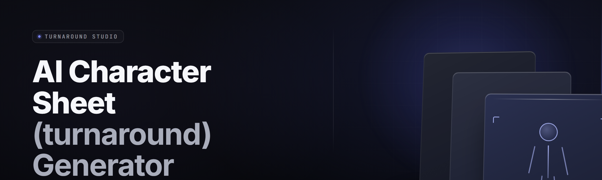

  
  
  

  

  
  
  

---

**AI Character Sheet (Turnaround) Generator — 2026** · turn a text prompt into a locked, multi-angle character sheet in seconds

---

## 🎭 Overview

The AI Character Sheet (Turnaround) Generator is a Windows desktop app that takes a short text description of a character and outputs a full turnaround sheet — front, three-quarter, side, and back views — locked to a single consistent identity. You type the vibe, the tool holds the face. No prompt surgery, no re-rolling, no drift between frames.

| Category | Details |
|---|---|
| **What it is** | Desktop app (`.exe`) that generates multi-angle character turnarounds from text |
| **Core outputs** | Expression sheet, T-pose turnaround, outfit variants, palette map, spec sheet |
| **Identity lock** | Optional reference-image lock keeps face/body consistent across all angles |
| **Project format** | `.turnaround` files — save, reload, iterate per character |
| **Rig-ready** | Exports align to a fixed canvas so frames drop straight into your pipeline |
| **Style control** | Line-art, cel, painted, pixel, manga, western — swap without losing the character |

A character sheet lives or dies on consistency. The moment the back view wears a different face than the front, the sheet is useless for modeling, cosplay, rigging, or reference. This tool exists to kill that drift.

  

---

## 📖 What is a turnaround sheet?

A **turnaround** (also called a model sheet) is the reference set animators, riggers, cosplayers, and illustrators work from. It shows one character from multiple fixed angles so everyone agrees on what the character looks like from any side.

| Term | Explanation |
|---|---|
| **Turnaround** | The full set of fixed-angle views (front / 3⁄4 / side / back) of one character |
| **Identity lock** | A seed + reference binding that forces all angles to render the same character |
| **Expression sheet** | A grid of the same face across emotions, same angle |
| **Spec sheet** | The written panel — height, build, palette hexes, distinguishing marks |
| **Palette map** | Extracted dominant colors that carry across every frame |
| **Drift** | When a later render slowly mutates away from the original face |
| **Rig frame** | A view exported to a fixed canvas so joints line up between angles |

Why a turnaround matters for anyone building characters:

- **Consistency is the whole product.** A modeler can't guess the side profile — they need it drawn.
- **Rigging needs aligned frames.** Joints must line up between front and 3⁄4 or the skeleton snaps.
- **Cosplay and commissioning** live off accurate back views and seam placement.
- **Iteration speed.** Describing a character once beats re-describing it ten times and hoping the model remembers.

---

## ✨ Key Features

| Feature | Description | Benefit |
|---|---|---|
| **Identity Augment** | Binds a seed lineage to all four angles | Face stops drifting between views |
| **Reference Lock** | Feed one image, lock the whole sheet to it | Your existing OC stays your OC |
| **Angle Composer** | Add custom angles (hero, action pose, crouch) | Sheets that fit your actual job |
| **Expression Grid** | 12 emotions on one fixed face | Animation-ready emotional range |
| **Palette Extractor** | Pulls and freezes dominant colors | Every frame uses the same skin tone |
| **Spec Sheet Builder** | Editable text panel beside the art | Hands off one file, not three |
| **Style Swap** | Repaint the set without changing identity | Same character, anime OR rendered |
| **Outfit Variants** | Costume swaps that keep the body locked | Wardrobe sheets for free |
| **Rig Canvas** | Fixed-size frames, joints aligned | Drops straight into Blender/Spine |
| **Batch Mode** | Queue a roster of characters overnight | Whole cast in one run |
| **Project Files** | `.turnaround` save/load per character | Iterate instead of restart |
| **Local Render** | Runs on your GPU, nothing leaves the machine | Private, offline, no queue tax |

---

## 🧩 The Problem

- You describe a character, get a great front view — then the side view is a **different person**.
- Back views are a coin flip. Hair length, scar placement, tattoo position — all guessed.
- Reference has to be **re-collected** every session because the model forgot.
- Palette swings between renders. Skin tone goes from warm to cold with no warning.
- Riggers reject sheets because **frames aren't aligned** to a shared canvas.
- Re-rolling to fix one angle **breaks the other three**.
- There's no single file that holds the art, the spec, and the palette together.

---

## 🛠️ The Solution

| Problem | Solution |
|---|---|
| Face drifts between angles | **Identity Augment** binds one identity lineage to all views |
| Existing OC not reproducible | **Reference Lock** anchors the sheet to a supplied image |
| Missing back/side detail | **Angle Composer** generates any angle you name |
| Palette inconsistency | **Palette Extract + Freeze** locks colors across frames |
| Unaligned rig frames | **Rig Canvas** exports to a fixed, joint-aligned grid |
| Re-roll breaks everything | **`.turnaround` project** preserves the whole set atomically |
| Scattered assets | **Spec Sheet Builder** bundles art, palette, and text in one file |

---

## 🚀 Quick Start

1. 🪟 Visit the project page and grab the `.exe`.
2. 📦 Extract the archive anywhere — no installer, no admin rights needed.
3. ▶️ Run the `.exe`. First launch indexes your local render backend.
4. 📝 Type a character description, or hit **Load Reference** to anchor to an image.
5. 🎯 Pick your angle set, hit **Generate Sheet**, and export rig frames or full PNGs.

---

## ⚖️ Comparison

| Aspect | Manual re-prompting | Reference-only tools | This Tool |
|---|---|---|---|
| Multi-angle consistency | Poor — drifts every roll | Front-only, no turnarounds | Identity lock across all angles |
| Back view generation | Guesswork | Usually absent | First-class output |
| Palette stability | None | Partial | Extracted and frozen |
| Project persistence | None | Per-image | One `.turnaround` file per character |
| Rig alignment | No | No | Fixed canvas, aligned joints |
| Style swap | Restart the sheet | Loses identity | Repaints, keeps identity |
| Offline / private | Depends | Usually cloud | Fully local |

---

## 🎮 Combat & Action Angle Modules

**Combat Pose Set** — dynamic combat stances rendered on the locked identity. **Weapon Grip Sheet** — hand and weapon framing across the four main angles. **Dodge & Impact Frames** — mid-motion captures for action sheets. **Damage State Views** — torn, dirty, bloodied variants that keep the same face.

1. **Combat Pose Set** — eight stance poses, identity-locked.
2. **Weapon Grip Sheet** — grip and reach reference per angle.
3. **Damage State Views** — wardrobe destruction that respects the body.

## 🧵 Crafting & Outfit Modules

4. **Outfit Variant Grid** — costume swaps on a locked body.
5. **Armor Layer Sheet** — layered gear rendered front-to-back.
6. **Prop Attachment Map** — where belts, pouches, and harnesses sit per angle.
7. **Material Reference Panel** — leather, cloth, and metal swatches tied to the outfit.

## 🎨 Visual & Style Modules

8. **Line-Art Mode** — clean inked turnaround for modelers.
9. **Cel-Shade Mode** — flat-shaded sheet for animation reference.
10. **Painted Mode** — full-render turnaround for pitch decks.
11. **Pixel Mode** — grid-locked sprite sheet from the same identity.
12. **Manga / Western Presets** — regional style packs that preserve the sheet.

## 📐 Rigging & Pipeline Modules

13. **Rig Canvas Export** — fixed frames aligned for Blender, Spine, and Live2D.
14. **Joint Marker Overlay** — light markers at shoulder, elbow, hip for riggers.
15. **Layer Split** — export line / color / shadow as separate PNG layers.
16. **Sprite Strip Export** — horizontal or vertical strips for engine import.

## 🧠 AI & Identity Modules

17. **Identity Augment Engine** — the seed lineage that keeps one face consistent.
18. **Reference Lock** — image-anchored identity binding.
19. **Palette Freeze** — color extraction plus lock across the whole sheet.

---

## 🔄 All Modules Status

| Module | Status | Description |
|---|---|---|
| Identity Augment Engine | ✅ Working | Binds one identity to every angle |
| Reference Lock | ✅ Working | Image-anchored character binding |
| Angle Composer | ✅ Working | Custom angle generation |
| Expression Grid | ✅ Working | 12-emotion fixed-face grid |
| Palette Freeze | ✅ Working | Extract + lock colors across frames |
| Rig Canvas Export | ✅ Working | Fixed canvas, aligned joints |
| Outfit Variant Grid | ✅ Working | Wardrobe swaps on locked body |
| Style Swap | ✅ Working | Repaint without identity loss |
| Sprite Strip Export | ✅ Working | Engine-ready strips |
| Batch Mode | ✅ Working | Roster queue for overnight runs |
| Layer Split | ⚙️ Beta | Separate line/color/shadow layers |
| Pixel Mode | ⚙️ Beta | Grid-locked sprite turnaround |
| Damage State Views | ✅ Working | Torn/state variants |
| Spec Sheet Builder | ✅ Working | Editable written panel |
| Weapon Grip Sheet | ✅ Working | Hand + weapon framing |
| Prop Attachment Map | ⚙️ Beta | Gear placement per angle |
| Material Reference Panel | ✅ Working | Swatch panel per outfit |
| Joint Marker Overlay | ✅ Working | Rig markers on every frame |
| Project Files (`.turnaround`) | ✅ Working | Atomic save/load per character |

---

## 💻 System Requirements

| Component | Minimum | Recommended |
|---|---|---|
| OS | Windows 10 64-bit | Windows 11 64-bit |
| CPU | 4-core x86-64 | 8-core x86-64 |
| RAM | 8 GB | 16 GB+ |
| GPU | 4 GB VRAM, DirectX 12 | 8 GB+ VRAM, CUDA-capable |
| Storage | 3 GB free | 15 GB free (batch cache) |
| Display | 1280×720 | 1920×1080+ |

---

## 🧲 Installation

1. **Get the archive.** Download the `.exe` package from the project page. It ships as a self-contained archive — everything needed is inside.
2. **Extract it.** Right-click → Extract All (or 7-Zip). Drop it anywhere with write access, like `D:\Tools\Turnaround`. Avoid `Program Files` unless you want to run as admin.
3. **Run the `.exe`.** Double-click it. First launch scans your GPU and picks a render backend automatically. No pip, no npm, no git clone, no runtime installs.

---

## ✅ Compatibility & Platform Support

| Platform / Format | Support | Notes |
|---|---|---|
| Windows 10 | ✅ Full | x64 only |
| Windows 11 | ✅ Full | Best GPU backend support |
| Blender rig import | ✅ Native | Via Rig Canvas PNG export |
| Spine / Live2D | ✅ Native | Joint-marker overlay recommended |
| Unity / Godot sprite import | ✅ Native | Sprite Strip Export |
| Linux / macOS | ❌ Not supported | Windows-only `.exe` |
| Cloud render | ❌ Not supported | Fully local by design |

---

## 🐞 Known Issues

| Issue | Solution |
|---|---|
| First render stalls a few seconds | Backend warmup — subsequent renders are instant |
| Back view face looks slightly off | Enable Reference Lock before generating |
| Palette shifts on style swap | Re-run Palette Freeze after swapping styles |
| Layer Split export missing shadows | Toggle shadows on in the layer panel first |
| Batch Mode hogging GPU | Lower batch concurrency in Settings |

---

## ❓ FAQ

| Question | Answer |
|---|---|
| Is it safe to run? | Yes — it's a local Windows app, no background services, no telemetry. |
| Does it need an internet connection? | No. Everything renders locally after install. |
| Can I use my existing OC? | Yes — load a reference image and Reference Lock anchors the sheet. |
| What files does it export? | PNG frames, sprite strips, layered PNGs, and a `.turnaround` project. |
| Does it work on Steam Deck? | No — Windows-only. |
| Are the frames rig-ready? | Yes — Rig Canvas exports aligned joints for Blender, Spine, and Live2D. |
| How many angles can I add? | Unlimited custom angles via the Angle Composer. |
| Can I render a whole cast? | Yes — Batch Mode queues a roster overnight. |
| Do I need admin rights? | No, as long as you extract outside `Program Files`. |

---

## 🤝 Contributing

The project is community-driven. Bug reports, feature requests, and angle presets all live in the repo. If you build a turnaround for a public character, drop a spec-sheet preset so others can reproduce the same locked identity. Community presets are what keep the sheet library growing.

---

## 🔚 Closing

Character sheets have always been the unglamorous backbone of character work — the boring set of drawings every modeler, rigger, and cosplayer quietly depends on. This tool makes that backbone fast, consistent, and completely yours. Lock an identity once, and every angle agrees with you from then on.

  

